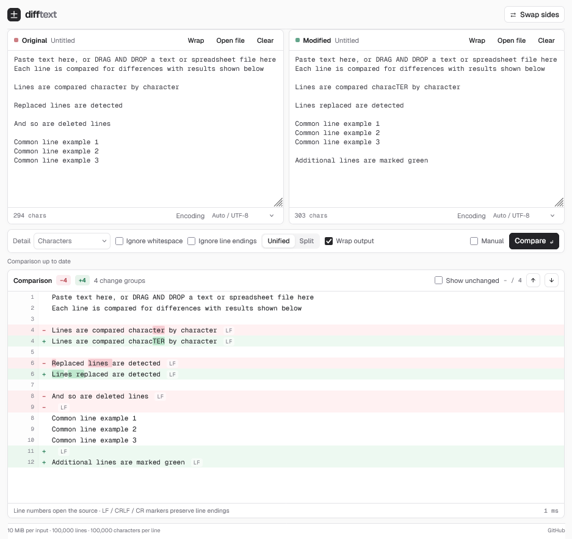

# diff-text

A compact, private text and spreadsheet comparison app built with React and Vite.
Text processing happens in local Web Workers. Geist and Geist Mono are bundled
with the app; there are no font CDN or document-upload requests.

The interface uses neutral, shadcn-style controls, labelled editors, visible
keyboard focus and a virtualised unified or split comparison view.



## Development

Use Node.js 20.19+ (20.x) or 22.12+, and pnpm 12.3.4 as pinned in
`package.json`. Use pnpm exclusively. The repository enforces a seven-day
minimum release age; keep it in place when adding or updating packages.

```sh
pnpm install
pnpm dev
```

```sh
pnpm lint
pnpm test
pnpm typecheck
pnpm format:check
pnpm build
pnpm check:worker
pnpm benchmark
```

- `pnpm check:worker` runs the generated production worker under a Node transport
  adapter. It checks exact EOF comparison, decoding and the lazy spreadsheet chunk.
  Run the build first. This does not replace browser validation.
- `pnpm benchmark` measures the source comparison and display-model generation
  without starting a listening server. Timings are diagnostic, not brittle test thresholds.
- `pnpm format` formats source, scripts and project configuration.
- `pnpm format:check` checks formatting without writing files.
- `pnpm typecheck` checks the JavaScript comparison, parsing, worker and diff-view
  contracts using JSDoc and TypeScript without generating output.
- `pnpm test:watch` runs tests during development.
- `pnpm preview` serves the production build locally.

## Using the app

Paste text, choose **Open file**, or drop one file into each editor. Swapping sides
uses the latest visible text and cancels unfinished imports.

Small inputs compare automatically after a short pause. Above 500,000 combined
UTF-16 code units, comparison requires **Compare**. Manual mode provides the same
behaviour for any input. Ctrl/Command + Enter also compares. Cancel stops the active
worker immediately; stale results remain clearly labelled.

- Characters, words, words with spaces, sentences and line-only detail.
- Exact trailing whitespace, final newlines and CR/LF/CRLF comparison by default.
- Explicit ignore-whitespace and ignore-line-ending options.
- Next/previous change navigation, expandable unchanged context, and source-line links.
- Optional editor wrapping. Source-line navigation turns wrapping off for accurate positioning.
- Automatic UTF-8/UTF-16 BOM detection and explicit UTF-8, UTF-16 or Windows-1252 decoding.
- Spreadsheet worksheet selection; selected sheets are converted to CSV values.
  Workbook structure, formatting and formula definitions are not compared.

The line-ending badge on changed rows makes otherwise invisible changes visible.
Very long output lines preview the first 2,000 characters and provide a link to
the full source line. Input text is retained in memory and is not persisted across reloads.

## Architecture and limits

- `TextInput` commits editor changes immediately; only comparison is debounced.
  Import generations prevent late results from overwriting edits, swaps or newer files.
- `useComparison` tracks document revisions and comparison options. Presentation
  changes do not rerun the diff.
- `jobs.js` owns worker creation, cancellation, deadlines and error settlement.
- `text.js` shares bounded validation and decoding. It scans without spreading
  line arrays into function arguments. Validation runs in the worker before comparison
  or acceptance of an import.
- `parse.js` limits file bytes, checks ZIP expansion and parses only the selected
  worksheet. `sheetRows`, worksheet dimensions and CSV validation prevent silent truncation.
- `compare.js` performs bounded line alignment and optional bounded inline detail.
  If the alignment budget is exceeded, it preserves matching edges and explicitly
  marks the unmatched middle as removed/added.
- `displayRows.js` constructs context with a linear scan. The renderer mounts only
  the visible rows plus overscan inside a bounded scroll viewport, including when
  unchanged lines are expanded. Wrapped rows are measured by the browser; unseen
  rows use provisional heights until mounted.

Limits are defined in `src/config.js`:

| Resource                                    | Limit                              |
| ------------------------------------------- | ---------------------------------- |
| File bytes / decoded UTF-8 text             | 10 MiB per side, inclusive         |
| Logical lines, counting an empty final line | 100,000                            |
| Characters per line                         | 100,000 UTF-16 code units          |
| Declared expanded workbook archive          | 64 MiB                             |
| Worksheet extent                            | 250,000 cells, at most 512 columns |
| Line-alignment budget                       | 1.5 seconds / edit distance 2,000  |
| Whole worker job                            | 20 seconds                         |

Large files automatically use line-only detail. Smaller inputs also have per-line
and aggregate inline budgets. A visible notice explains any fallback; the app does
not silently discard differences. A worker improves responsiveness but cannot
guarantee a browser-wide memory ceiling for every malformed workbook. ZIP64
workbooks are rejected.

Tests cover races, worker failures and cancellation, exact round-tripping,
encoding, worksheet limits, virtualisation and source navigation. Browser smoke
tests are run only when requested.

SheetJS is pinned to the official 0.20.3 tarball, which includes fixes for
CVE-2023-30533 and CVE-2024-22363. The registry release 0.18.5 is not used.

## References

- [jsdiff](https://github.com/kpdecker/jsdiff)
- [SheetJS](https://docs.sheetjs.com/)
- [Fontsource](https://fontsource.org/)
- [Source repository](https://github.com/andygock/diff-text)
